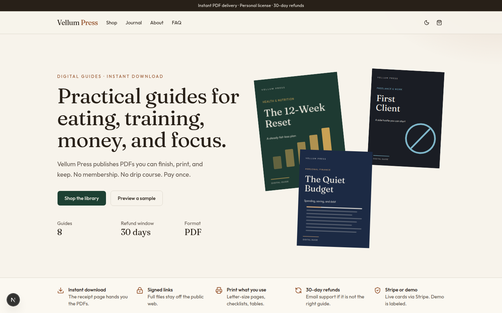
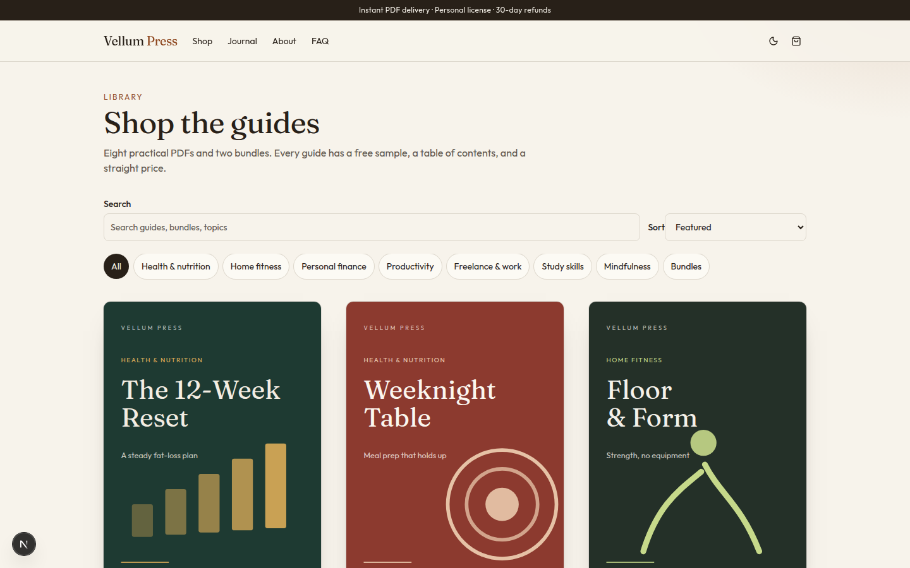
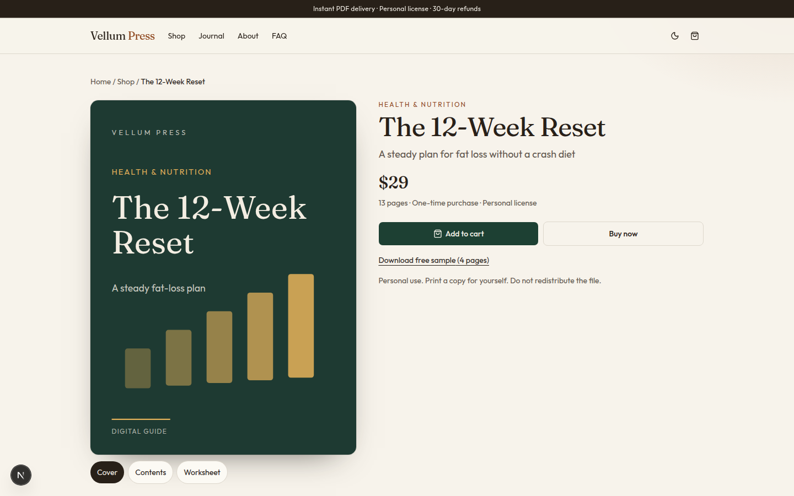
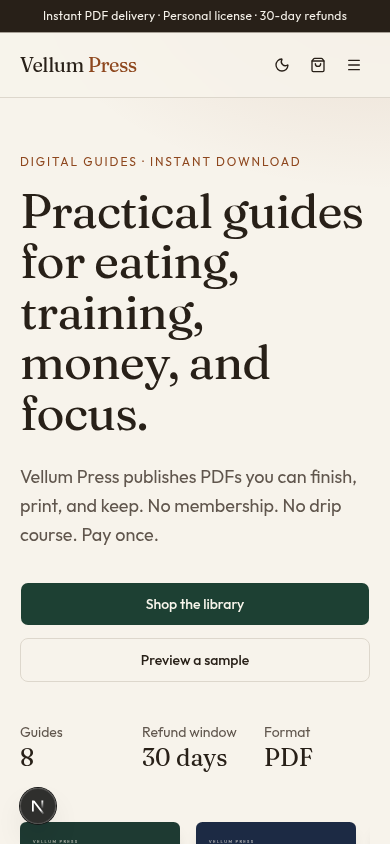

# Vellum Press

Vellum Press is a small storefront for practical PDF guides: health, home training, money, habits, freelance work, study, and stress. Customers pay once, download the files, and keep them. There is no membership and no account.

The shop runs without payment keys. Checkout is labeled as a demo and still produces a signed download link. Add Stripe keys to charge cards, PayPal keys to offer PayPal, or Moyasar keys to offer mada, Visa, Mastercard, Apple Pay, and STC Pay in Saudi riyals.









## What’s in the library

| Guide | Price | Category |
| --- | ---: | --- |
| The 12-Week Reset | $29 | Health & nutrition |
| Weeknight Table | $24 | Health & nutrition |
| Floor & Form | $27 | Home fitness |
| The Quiet Budget | $22 | Personal finance |
| The Habit Ledger | $19 | Productivity |
| First Client | $32 | Freelance & work |
| The Exam Room Method | $21 | Study skills |
| Steady Mind | $18 | Mindfulness |
| Health & Fitness Bundle | $59 (was $80) | Reset, Weeknight Table, and Floor & Form |
| Work & Money Bundle | $58 (was $73) | Quiet Budget, Habit Ledger, and First Client |

Each guide has a free sample PDF in `public/samples/` and a full PDF in `private/pdfs/`. Full files are not served as public URLs. A purchase creates a signed link that expires after `DOWNLOAD_LINK_DAYS` (14 by default).

Health, fitness, and stress guides include a plain-language disclaimer. They are education, not medical care or therapy. Finance and freelance guides say where a licensed professional has to take over.

Testimonials on the home page, and the reviews on product pages, are marked **Sample**. They are layout content, not verified buyers. Do not turn them into structured rating data.

## Run it locally

Node 20+ and npm. Python 3 is only needed if you regenerate the PDFs.

```bash
npm install
npm run dev
```

Open [http://127.0.0.1:43123](http://127.0.0.1:43123).

```bash
npm test
npm run lint
npm run build
```

Copy `.env.example` to `.env.local` when you want to override the defaults. The app runs with no env file.

## Environment variables

| Variable | Required | Purpose |
| --- | --- | --- |
| `NEXT_PUBLIC_SITE_URL` | For production | Canonical URLs, sitemap, Open Graph. Example: `https://guides.example.com` |
| `DOWNLOAD_SECRET` | Required in production | HMAC secret for download links. Use a long random string (16+ characters). |
| `DOWNLOAD_LINK_DAYS` | No | Lifetime of a download link. Default 14. |
| `STRIPE_SECRET_KEY` | For card charges | Secret key from the Stripe dashboard. |
| `NEXT_PUBLIC_STRIPE_PUBLISHABLE_KEY` | No | Unused by hosted Checkout. Kept for a future Stripe.js form. |
| `STRIPE_WEBHOOK_SECRET` | For webhooks | Signing secret for `POST /api/stripe/webhook`. |
| `PAYPAL_CLIENT_ID` | For PayPal | Client ID from a PayPal REST app. Both this and the secret are required before the PayPal button appears. |
| `PAYPAL_CLIENT_SECRET` | For PayPal | Secret from the same REST app. Never commit it. |
| `PAYPAL_ENV` | No | `sandbox` (default) or `live`. Any value other than `live` uses the sandbox API. |
| `PAYPAL_WEBHOOK_ID` | No | Webhook id for `POST /api/paypal/webhook`. Downloads are issued on the return URL, not by the webhook. |
| `MOYASAR_PUBLISHABLE_KEY` | For Moyasar | Publishable key (`pk_test_` or `pk_live_`) for the Moyasar payment form. Both this and the secret are required before the Moyasar option appears. |
| `MOYASAR_SECRET_KEY` | For Moyasar | Secret key (`sk_test_` or `sk_live_`) used only on the server to fetch and verify payments. Never commit it. Must be the same mode as the publishable key. |
| `MOYASAR_WEBHOOK_SECRET` | No | Shared secret you choose in the Moyasar webhook settings. `POST /api/moyasar/webhook` checks it. Downloads are issued on the callback, not by the webhook. |
| `USD_TO_SAR_RATE` | No | USD to SAR rate for Moyasar charges. Default `3.75` (the official peg). Amounts are converted to halalas on the server. |
| `MOYASAR_APPLE_PAY_DOMAIN_ASSOCIATION` | For Apple Pay | Body of the domain association file from the Moyasar dashboard. Served at `/.well-known/apple-developer-merchantid-domain-association`. |
| `ALLOW_DEMO_CHECKOUT` | No | Set to `true` only if demo checkout should stay available after Stripe, PayPal, or Moyasar is connected. Leave unset on a live store. |
| `CONTACT_WEBHOOK_URL` | No | JSON endpoint that receives contact-form posts. |
| `NEWSLETTER_WEBHOOK_URL` | No | JSON endpoint that receives newsletter signups. |

## Checkout and delivery

Prices are read from `data/products.ts` on the server. The browser cannot set the amount.

**Demo mode** (no Stripe secret, no PayPal client id/secret, and no Moyasar key pair): the checkout page says no payment will be collected. Confirming the order signs a download token and opens the receipt. The receipt is stamped as a demo. Each configured provider gets its own button. If none are configured, demo mode stays.

**Stripe mode**: `POST /api/checkout` creates a Checkout Session with `price_data` in USD and redirects the buyer to Stripe. You do not have to pre-create Products in the dashboard. Success returns to `/checkout/success?session_id=...`. The server retrieves the session, checks `payment_status === "paid"`, recomputes the files from the catalog, and signs the same kind of token. Cancel returns to `/checkout?canceled=1`. The cart in the browser is unchanged until payment is confirmed.

`POST /api/stripe/webhook` verifies `STRIPE_WEBHOOK_SECRET` and acknowledges `checkout.session.completed`. Fulfillment already happens on the success page, which is enough for a single digital delivery. Use the webhook later if you email files from a worker. In the Stripe dashboard, point the endpoint at `https://YOUR_DOMAIN/api/stripe/webhook` and subscribe to `checkout.session.completed`.

**PayPal mode**: `POST /api/paypal/checkout` recomputes the cart from `data/products.ts` (bundle prices included; the browser total is ignored) and creates a PayPal Orders v2 order with `intent: CAPTURE`. The buyer is redirected to PayPal to approve it. Cancel returns to `/cart?canceled=1`. Approval returns to `GET /api/paypal/return`, which captures the order, requires status `COMPLETED`, and checks that the captured currency is USD and the captured amount matches the catalog total. Only then does it sign a download token with the usual 14-day expiry and redirect to the receipt. Private PDFs are not sent before that check. A mismatch or a failed capture sends the buyer back to checkout with an explanation and does not issue a link.

`POST /api/paypal/webhook` verifies the transmission with `PAYPAL_WEBHOOK_ID` when that variable is set. It acknowledges the event and does not release files. Point the webhook at `https://YOUR_DOMAIN/api/paypal/webhook`.

### PayPal setup

1. Open the [PayPal Developer Dashboard](https://developer.paypal.com/dashboard/applications) and create a REST app. Use the sandbox app while testing, and a live app when you are ready to charge real PayPal accounts.
2. Copy that app's Client ID and Secret.
3. In the Vercel project, set `PAYPAL_CLIENT_ID`, `PAYPAL_CLIENT_SECRET`, and `PAYPAL_ENV` (`sandbox` or `live`). Set `NEXT_PUBLIC_SITE_URL` to the https origin PayPal will redirect back to.
4. Optional: in the same app, add a webhook for `https://YOUR_DOMAIN/api/paypal/webhook` and set `PAYPAL_WEBHOOK_ID` to the webhook id PayPal shows. Checkout works without it.

**Moyasar mode**: `POST /api/moyasar/session` recomputes the cart from `data/products.ts`, including bundle prices, and ignores any amount sent by the browser. It converts the USD subtotal to SAR halalas with `USD_TO_SAR_RATE` (default 3.75) and returns the publishable key plus that amount. The checkout page then mounts [Moyasar's payment form](https://docs.moyasar.com/guides/card-payments/basic-integration) (`moyasar-payment-form` 2.3.0) with methods `creditcard` (mada, Visa, Mastercard), `applepay`, and `stcpay`. Card data is entered in that form and sent to Moyasar, not to this server. After payment, Moyasar redirects to `GET /api/moyasar/callback` with the payment id. The callback fetches `GET https://api.moyasar.com/v1/payments/:id` with the secret key and signs a download token only when status is `paid`, the currency is `SAR`, the amount matches the server-computed halalas, the payment is not refunded, and the payment's callback URL is the signed checkout state for this cart. Anything else returns the buyer to `/checkout?moyasar=failed` and does not issue a link. The SAR amount is shown on the checkout page before the form is used.

`POST /api/moyasar/webhook` checks the `secret_token` field against `MOYASAR_WEBHOOK_SECRET` when that variable is set, and for `payment_paid` it fetches the payment again. It acknowledges the event and does not release files. Point the webhook at `https://YOUR_DOMAIN/api/moyasar/webhook`.

### Moyasar setup

1. Create a Moyasar account at the [Moyasar dashboard](https://dashboard.moyasar.com/). Start in test mode. Sandbox keys start with `pk_test_` and `sk_test_`.
2. Copy the publishable key and the secret key. In the Vercel project, set `MOYASAR_PUBLISHABLE_KEY` and `MOYASAR_SECRET_KEY`. Do not commit them. Set `NEXT_PUBLIC_SITE_URL` to the https origin Moyasar will redirect back to, and set `DOWNLOAD_SECRET`.
3. Leave `USD_TO_SAR_RATE` at `3.75` unless you have a reason to charge a different riyal rate. The catalog stays in US dollars. Checkout shows the converted SAR total before the customer pays.
4. Use Moyasar's [test cards](https://docs.moyasar.com/guides/card-payments/test-cards). A name of at least two words, any future expiry, and any 3-digit CVC are accepted. Examples that return `paid`: mada `4201320111111010`, Visa `4111111111111111` and `4111114005765430`. Other numbers in that table simulate declines. Random card numbers fail in test mode.
5. Optional webhook: in Moyasar, open Settings → Webhooks, add `https://YOUR_DOMAIN/api/moyasar/webhook`, choose POST, set a secret token, and subscribe to `payment_paid`. Put that same token in `MOYASAR_WEBHOOK_SECRET`. Checkout works without the webhook.
6. Apple Pay on the web needs [Moyasar domain registration](https://docs.moyasar.com/guides/apple-pay/web-registration). Register the exact hostname the payment starts from (a Vercel subdomain must be registered as that subdomain, not the parent domain). Download the association file and set `MOYASAR_APPLE_PAY_DOMAIN_ASSOCIATION` to its contents, with no `.txt` extension. This app serves it at `/.well-known/apple-developer-merchantid-domain-association`. In the dashboard, click Validate, then Register. Apple Pay only appears on supported Apple devices over HTTPS. The form asks Moyasar to start the session at `https://api.moyasar.com/v1/applepay/initiate`, so you do not need a separate Apple Developer merchant certificate for this web flow.
7. STC Pay has to be enabled on the Moyasar account. Ask Moyasar (care@moyasar.com) if the STC Pay button does not appear. The form still offers the card methods without it.
8. Going live needs a live Moyasar account. Moyasar activates live payments after you provide a commercial registration or a freelance document. Then replace the keys with `pk_live_` and `sk_live_`, keep the site on HTTPS, and register the production domain for Apple Pay again.

Download links look like `/orders/<token>` and `/api/download/<token>/<slug>`. The token is `base64url(payload)~hmac`. The payload holds the order id, email, line items, file slugs, and expiry. The API checks the signature, the expiry, and that the file belongs to the order, then streams the PDF from `private/pdfs/`. Anyone with the link can download until it expires, so the receipt should be treated like a secret.

The cart is stored in `localStorage` under `vellum-cart-v1`.

Contact and newsletter forms validate input. If the matching webhook URL is unset, they tell the sender that the message was validated and not emailed. A hidden company field is a honeypot.

## Add or edit a guide

1. Add the product to `data/products.ts`. Guides use `kind: "guide"`. Bundles use `kind: "bundle"` and an `includes` array of guide slugs. Set `compareAtPrice` on a bundle to the sum of the included prices. The tests check that.
2. Add the chapter text in `scripts/pdfgen/books_health.py` or `scripts/pdfgen/books_life.py`. Chapter titles should match the `contents` list on the product.
3. Give the cover the same colors and motif the site uses (`path`, `plate`, `form`, `ledger`, `grid`, `mark`, `bars`, `breath`, `bundle`).
4. Regenerate the PDFs (below). `data/pdf-meta.json` picks up the page counts the site displays.
5. Optional: add sample reviews in `data/reviews.ts` with `sample: true`, and a journal post in `data/blog.ts`.

Do not put full PDFs in `public/`. Samples belong in `public/samples/<slug>-sample.pdf`.

## Regenerate the PDFs

```bash
python3 -m pip install -r scripts/requirements.txt
python3 scripts/generate_pdfs.py
```

The script uses ReportLab and the SIL Open Font License Liberation fonts in `scripts/fonts/` (see `scripts/fonts/OFL.txt`). It writes full guides, sample previews, and `data/pdf-meta.json`. It refuses to finish if a full guide is under 10 pages, a sample is under 3, or a chapter title or disclaimer is missing from the extracted text.

## Deploy

### Vercel

1. Import the repository.
2. Set `NEXT_PUBLIC_SITE_URL` to the production origin, and set `DOWNLOAD_SECRET`.
3. Add `STRIPE_SECRET_KEY` and `STRIPE_WEBHOOK_SECRET` when you want card charges.
4. Add `PAYPAL_CLIENT_ID`, `PAYPAL_CLIENT_SECRET`, and `PAYPAL_ENV` when you want PayPal. See the PayPal setup steps above.
5. Add `MOYASAR_PUBLISHABLE_KEY` and `MOYASAR_SECRET_KEY` when you want mada, cards, Apple Pay, or STC Pay. See the Moyasar setup steps above, including the Apple Pay domain file.
6. Deploy. `npm run build` is the build command. No database is required.

The success URL is built from `NEXT_PUBLIC_SITE_URL` in production, so set that before the first real payment.

### Netlify

Next.js on Netlify needs the [Next.js runtime](https://docs.netlify.com/frameworks/next-js/overview/). Set the same environment variables. API routes and server-rendered receipt pages have to run on the Next runtime, not as a purely static export. Do not set `output: "export"`.

## Before you take real payments

Replace the placeholder business in `data/site.ts`:

- legal name (`Vellum Press` is the working name)
- `hello@vellumpress.example` and `support@vellumpress.example`
- location and the governing law used by the legal pages (currently Oregon)
- the refund window if 30 days is not your policy

Have a lawyer read `data/legal.ts` before you rely on it. The pages are a practical starting point for a US digital-goods shop, not a law-firm opinion.

Then:

- set `NEXT_PUBLIC_SITE_URL` and `DOWNLOAD_SECRET`
- add Stripe keys and a webhook, PayPal REST app credentials, Moyasar keys, or any combination
- leave `ALLOW_DEMO_CHECKOUT` unset
- point `CONTACT_WEBHOOK_URL` and `NEWSLETTER_WEBHOOK_URL` at your inbox tool (a Zapier, Make, or Formspark endpoint is enough)
- remove or replace the sample testimonials and sample reviews when you have real ones
- put your own domain on the host and confirm `/sitemap.xml` and `/robots.txt`

## Project map

- `data/products.ts` — catalog, prices, contents, FAQs, cover art
- `data/site.ts` — business name, emails, location
- `data/blog.ts`, `data/legal.ts`, `data/faq.ts` — journal, policies, store FAQ
- `app/` — pages and route handlers
- `private/pdfs/` — full guides, served only through the signed download route
- `public/samples/` — free previews
- `scripts/generate_pdfs.py` — rebuilds every PDF
